<div align="center">

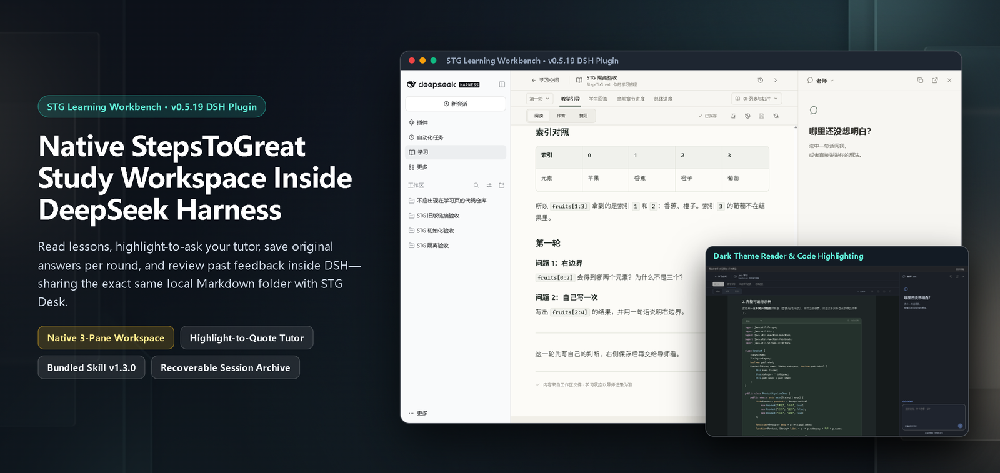

<h1>STG Learning Workbench</h1>

<p><strong>Native DeepSeek Harness (DSH) plugin for StepsToGreat: read lessons, highlight-to-ask your tutor, save original answers per round, and review past feedback in one workspace.</strong></p>

<p>
  <a href="https://github.com/wildcat430524/dsh-stg-learning/releases/latest"></a>
  <a href="https://github.com/wildcat430524/dsh-stg-learning/actions/workflows/ci.yml"></a>
  <a href="https://github.com/wildcat430524/dsh-stg-learning/releases"></a>
  
  <a href="LICENSE"></a>
</p>

<p>
  <strong><a href="https://github.com/wildcat430524/dsh-stg-learning/releases/latest">Download Plugin (.tgz, v0.5.19)</a></strong> ·
  <a href="#native-study-flow">Study Flow</a> ·
  <a href="#feature-gallery">Screenshots</a> ·
  <a href="#install-and-start-learning">Install</a> ·
  <a href="#stepstogreat-ecosystem">Ecosystem</a> ·
  <a href="#documentation">Docs</a>
</p>

<p><a href="README.md">简体中文</a> | <strong>English</strong></p>

</div>

---

**Study StepsToGreat courses natively inside DeepSeek Harness (DSH).** Pick your learning space in the sidebar, read and answer round-by-round in the center workbench, and talk to your tutor in DSH's native session pane—all lessons, original answers, and assessments stay as plain Markdown inside your local study folder.

> **[v0.5.19](https://github.com/wildcat430524/dsh-stg-learning/releases/tag/v0.5.19)** bundles **Steps2Great Skill 1.3.0** and passes 241 unit tests plus 40 isolated host checks against DSH 0.2.2-rc.3 (compatible with DSH 0.2.1-rc.1–rc.5 and 0.2.2-rc.1/rc.3). See [v0.5.19 release notes](docs/releases/v0.5.19.md) and [VERIFICATION.md](VERIFICATION.md).

---

## Native Study Flow

<p align="center">
  <picture>
    <source media="(prefers-color-scheme: dark)" srcset=".github/assets/workflow-en-dark.png">
    <source media="(prefers-color-scheme: light)" srcset=".github/assets/workflow-en-light.png">
    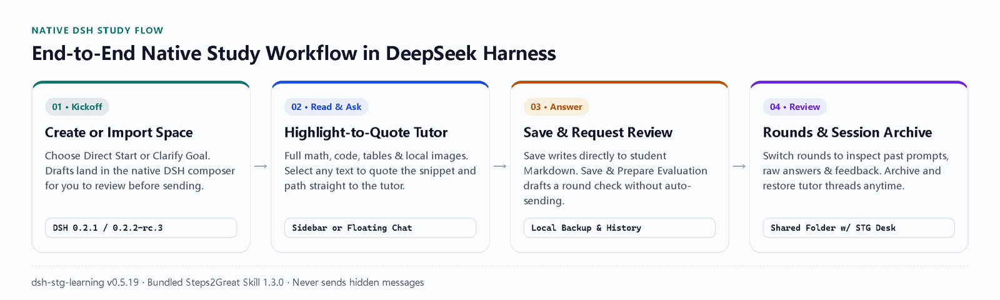
  </picture>
</p>

- **Zero hidden messages**: kickoff prompts, highlighted quotes, and evaluation requests are always placed into the DSH composer as drafts for you to review and send.
- **On-demand context**: the bundled tutoring Skill routes ordinary Q&A, hints, formal grading, and resuming separately while preserving every raw answer and revision.

---

## Feature Gallery

<table>
  <tr>
    <td width="50%" valign="top">
      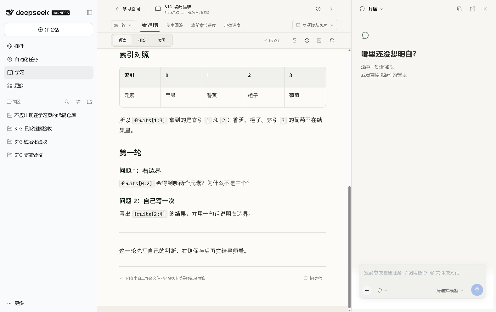<br>
      <sub><strong>Native 3-Pane Workbench.</strong> Browse study spaces and lessons on the left, read Markdown guides with math/code/tables and answer in the middle, and chat with your tutor on the right.</sub>
    </td>
    <td width="50%" valign="top">
      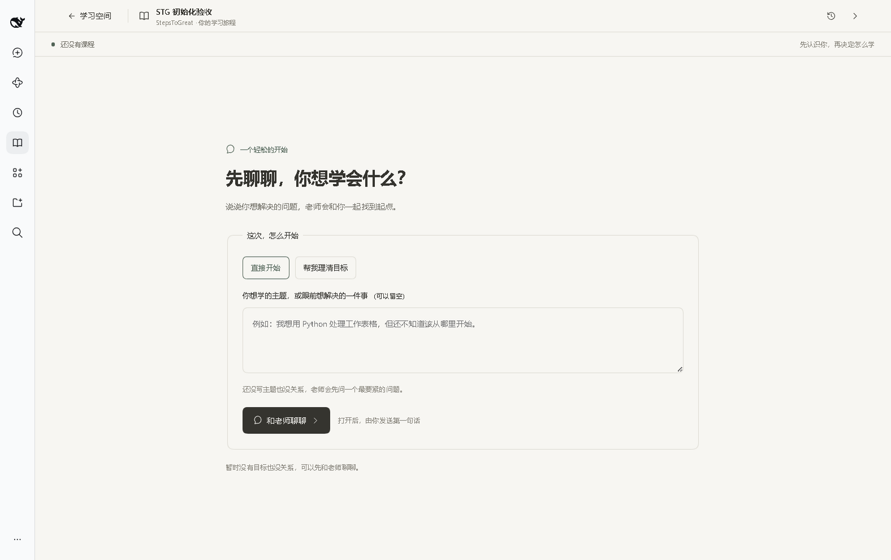<br>
      <sub><strong>Two Guided Kickoff Modes.</strong> Choose <em>Direct Start</em> when you already have a topic or question, or <em>Help Clarify Goal</em> to pin down your starting point one question at a time.</sub>
    </td>
  </tr>
  <tr>
    <td width="50%" valign="top">
      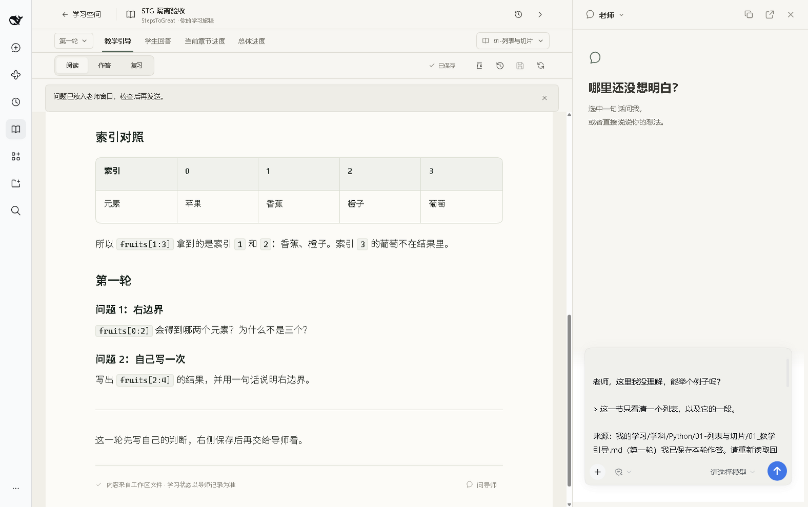<br>
      <sub><strong>Highlight-to-Quote Tutor.</strong> Select any sentence or code block in the lesson to ask your tutor—the exact excerpt, file path, and round context are drafted into the DSH input box.</sub>
    </td>
    <td width="50%" valign="top">
      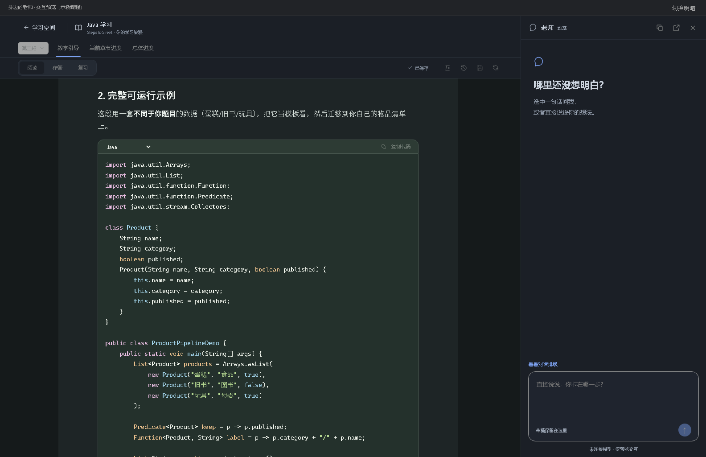<br>
      <sub><strong>Light & Dark Reader + WYSIWYG Editing.</strong> Supports KaTeX formulas, tables, local images (PNG/JPEG/GIF/WebP), and syntax-highlighted code blocks with copy buttons.</sub>
    </td>
  </tr>
  <tr>
    <td width="50%" valign="top">
      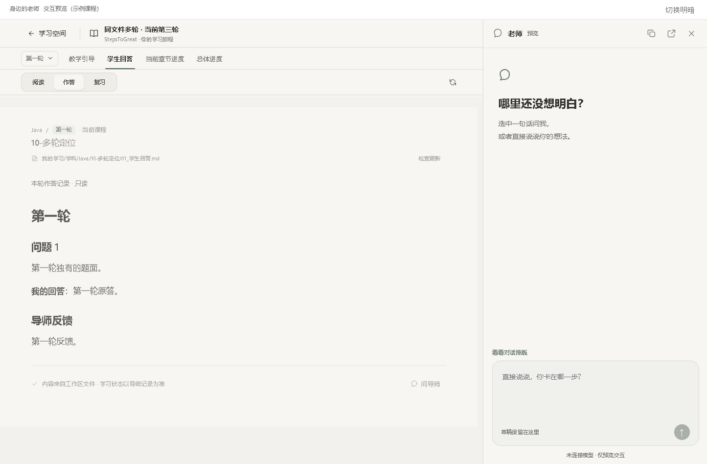<br>
      <sub><strong>Round Switching & History Review.</strong> Switch rounds from the upper-left selector to inspect past prompts, saved answers, and tutor feedback; return to the active round to continue your draft.</sub>
    </td>
    <td width="50%" valign="top">
      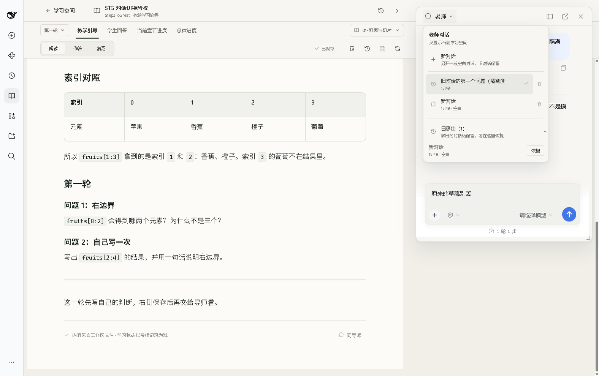<br>
      <sub><strong>Recoverable Session Archive.</strong> Continue existing threads, start fresh on a new topic, or archive and restore tutor conversations anytime without losing current input drafts.</sub>
    </td>
  </tr>
  <tr>
    <td width="50%" valign="top">
      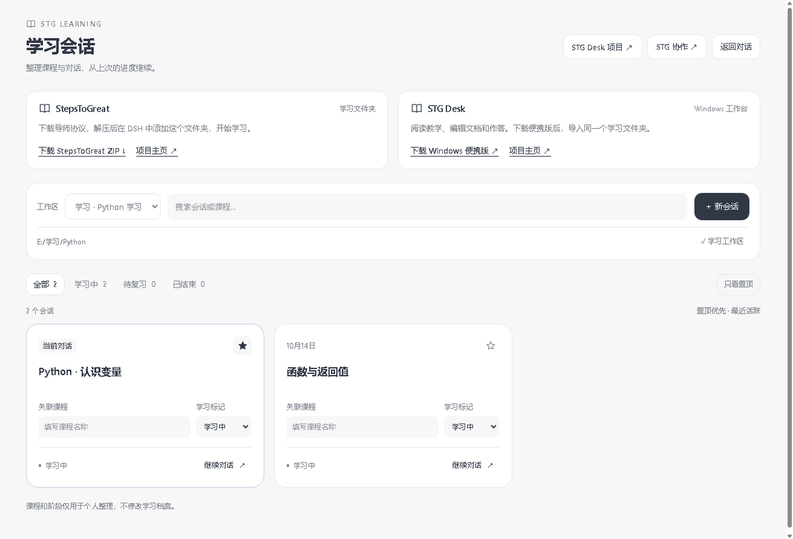<br>
      <sub><strong>Learning Sessions Organizer.</strong> Filter threads across workspaces by status (Studying / Pending Review / Completed), pin key sessions, or jump straight to STG Desk.</sub>
    </td>
    <td width="50%" valign="top">
      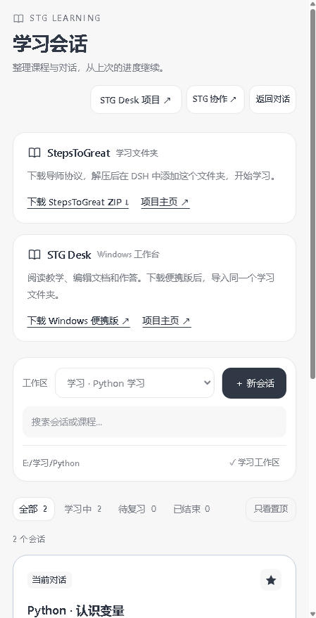<br>
      <sub><strong>Responsive Narrow Layout.</strong> Adapts cleanly to narrow sidebars and compact windows without hiding primary study actions.</sub>
    </td>
  </tr>
</table>

> All screenshots come from isolated test environments with sample lessons—no real learner data or live model logs are included.

---

## Install and Start Learning

1. **Install the plugin**: download `dsh-stg-learning-*.tgz` from [GitHub Releases](https://github.com/wildcat430524/dsh-stg-learning/releases/latest), open DSH's Plugins page, install from local file, and enable it (restart DSH if prompted).
2. **Open a learning space**: click Learning in the left sidebar—choose **New Study** to initialize a fresh folder, or **Import Existing StepsToGreat Folder** and pick your project root.
3. **Start chatting**: enter what you want to learn or where you are stuck, pick Direct Start or Help Clarify Goal, click to open the tutor chat, review the draft, and send.

<details>
<summary><strong>Install via DSH CLI</strong></summary>

```sh
dsh plugin --profile desktop add /absolute/path/dsh-stg-learning-0.5.19.tgz
```

</details>

---

## Where Your Files Live

| Data | Storage & Recovery |
| :--- | :--- |
| Teaching, raw answers & profile | Local Markdown files in your chosen folder, version-checked before writes |
| Session links & doc backups | `.stg-desk/` inside your folder; preview and restore older versions in Document History |
| Unsaved edits & answer drafts | Local browser storage used by DSH (external edits alert you and preserve your draft) |
| Tutor threads, models & accounts | Managed natively by DeepSeek Harness |

> Supports UTF-8 Markdown & TXT up to 8 MiB per file, including KaTeX math, code, tables, and local PNG/JPEG/GIF/WebP images. Convert PDF/Word files to Markdown first.

---

## StepsToGreat Ecosystem

This plugin shares the exact same local Markdown folder with the portable framework, Agent Skill, and Windows desktop workbench—switch freely between DSH and STG Desk on the same files:

<p align="center">
  <picture>
    <source media="(prefers-color-scheme: dark)" srcset=".github/assets/ecosystem-en-dark.png">
    <source media="(prefers-color-scheme: light)" srcset=".github/assets/ecosystem-en-light.png">
    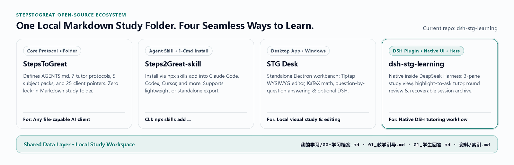
  </picture>
</p>

| Repository | Role | How It Connects |
| :--- | :--- | :--- |
| [StepsToGreat](https://github.com/wildcat430524/StepsToGreat/blob/main/README.en.md) | Open protocol & folder format | Defines lessons, rounds, and profile structure ([Download ZIP](https://github.com/wildcat430524/StepsToGreat/archive/refs/heads/main.zip)) |
| [Steps2Great-skill](https://github.com/wildcat430524/Steps2Great-skill/blob/main/README.en.md) | Agent Skill (`npx skills add`) | Supplies the bundled tutoring rules and state checks used here |
| [STG-Desk](https://github.com/wildcat430524/STG-Desk/blob/main/README.en.md) | Windows desktop workbench | Opens the exact same local study folder for offline WYSIWYG reading & answering |
| **dsh-stg-learning** (this repo) | DeepSeek Harness plugin | Embeds the 3-pane workbench, quote-to-ask & session organizer natively inside DSH |

---

## FAQ

<details>
<summary><strong>What is the difference between "Save Answer" and "Save & Prepare Evaluation"?</strong></summary>

**Save Answer** writes your work only to the local student Markdown file. **Save & Prepare Evaluation** saves your answers and prepares a standardized review draft in the DSH composer for you to review before sending.

</details>

<details>
<summary><strong>Why does a newly created space show "No lessons yet"?</strong></summary>

New spaces start with an empty profile and protocol scaffold. Click to chat with your tutor about what you want to learn—once the tutor publishes Lesson 1, it loads in the workbench automatically.

</details>

<details>
<summary><strong>Which folder should I pick when importing?</strong></summary>

Choose the **StepsToGreat root directory** that contains `我的学习/00-学习档案.md` along with the tutor protocol or `.steps2great.json` marker.

</details>

---

## Documentation

| Guide | Contents |
| :--- | :--- |
| [LEARNING-SPACES.md](docs/LEARNING-SPACES.md) | Creating, importing, legacy directory detection & folder anatomy |
| [NATIVE.md](docs/NATIVE.md) | Native DSH tutor session wiring, draft prefill & navigation |
| [HOST.md](docs/HOST.md) | Host file read/write, version checks & document recovery contract |
| [VERIFICATION.md](VERIFICATION.md) | Verified DSH versions, test commands & coverage |

---

## Development & Contributing

Requires **Node.js 24+**. From the repository root:

```sh
npm ci
npm run build
npm test
```

- Run `npm pack` to build the `.tgz` plugin archive. Browser and native host suites require setting `STG_ELECTRON_PATH` before running `npm run test:browser` or `npm run test:native`.
- Please include plugin version, DSH version, and sanitized reproduction steps when reporting issues. [New Issue](https://github.com/wildcat430524/dsh-stg-learning/issues/new) · If this plugin helps your studies, consider leaving a ⭐ Star!

## License

Plugin code is licensed under [MIT](LICENSE). Reused STG Desk components and bundled dependencies retain their respective licenses; see [THIRD-PARTY-NOTICES.md](THIRD-PARTY-NOTICES.md).
