<div align="center">

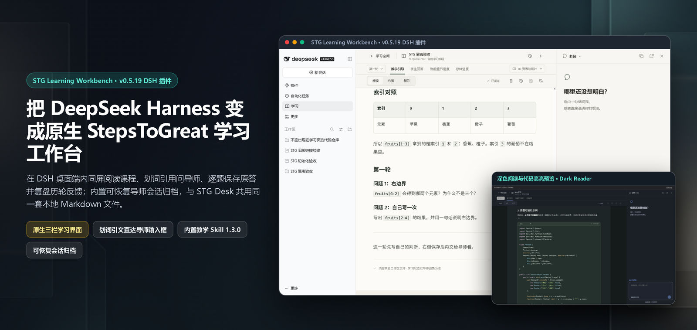

<h1>STG Learning Workbench</h1>

<p><strong>DeepSeek Harness（DSH）原生学习插件：在熟悉的对话界面里同屏读课、划词问导师、逐题留档原答并复盘历轮反馈。</strong></p>

<p>
  <a href="https://github.com/wildcat430524/dsh-stg-learning/releases/latest"></a>
  <a href="https://github.com/wildcat430524/dsh-stg-learning/actions/workflows/ci.yml"></a>
  <a href="https://github.com/wildcat430524/dsh-stg-learning/releases"></a>
  
  <a href="LICENSE"></a>
</p>

<p>
  <strong><a href="https://github.com/wildcat430524/dsh-stg-learning/releases/latest">下载插件包 (v0.5.19)</a></strong> ·
  <a href="#原生学习闭环">学习闭环</a> ·
  <a href="#界面功能全景">界面全景</a> ·
  <a href="#安装并开始学习">快速安装</a> ·
  <a href="#stepstogreat-开源生态">生态全家桶</a> ·
  <a href="#项目文档">项目文档</a>
</p>

<p><strong>简体中文</strong> | <a href="README.en.md">English</a></p>

</div>

---

**在 DeepSeek Harness（DSH）里原生学习 StepsToGreat 课程。** 从你真正想解决的问题起步，左侧进入学习空间、中间沉浸式阅读与逐题作答、右侧连接完整 DSH 导师会话；课程、原答与评估证据全部以 Markdown 保存在你自己的本地学习目录中。

> 当前版本 **[v0.5.19](https://github.com/wildcat430524/dsh-stg-learning/releases/tag/v0.5.19)** 内置 **Steps2Great Skill 1.3.0**，已在 DSH 0.2.2-rc.3 隔离宿主通过 40 项原生检查与 241 项单元测试（兼容 DSH 0.2.1-rc.1–rc.5 及 0.2.2-rc.1/rc.3）。详见 [v0.5.19 发布说明](docs/releases/v0.5.19.md) 与 [验收记录](VERIFICATION.md)。

---

## 原生学习闭环

<p align="center">
  <picture>
    <source media="(prefers-color-scheme: dark)" srcset=".github/assets/workflow-zh-dark.png">
    <source media="(prefers-color-scheme: light)" srcset=".github/assets/workflow-zh-light.png">
    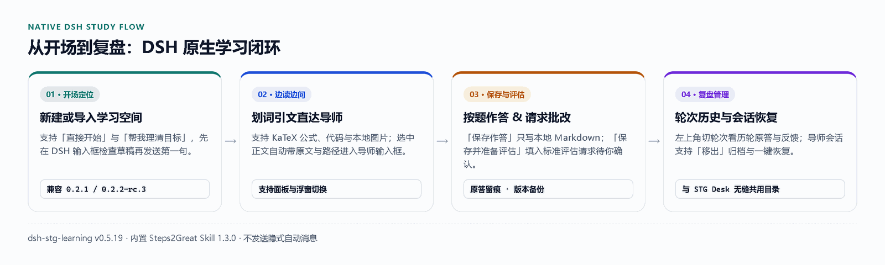
  </picture>
</p>

- **不擅自代发消息**：所有开场请求、划词提问与评估指令都先作为草稿放进 DSH 输入框，由你确认后再发送。
- **按需读取课件**：内置 Skill 先区分日常答疑、提示、正式批改与续学，再读取所需内容，完整保留原答与修订记录。

---

## 界面功能全景

<table>
  <tr>
    <td width="50%" valign="top">
      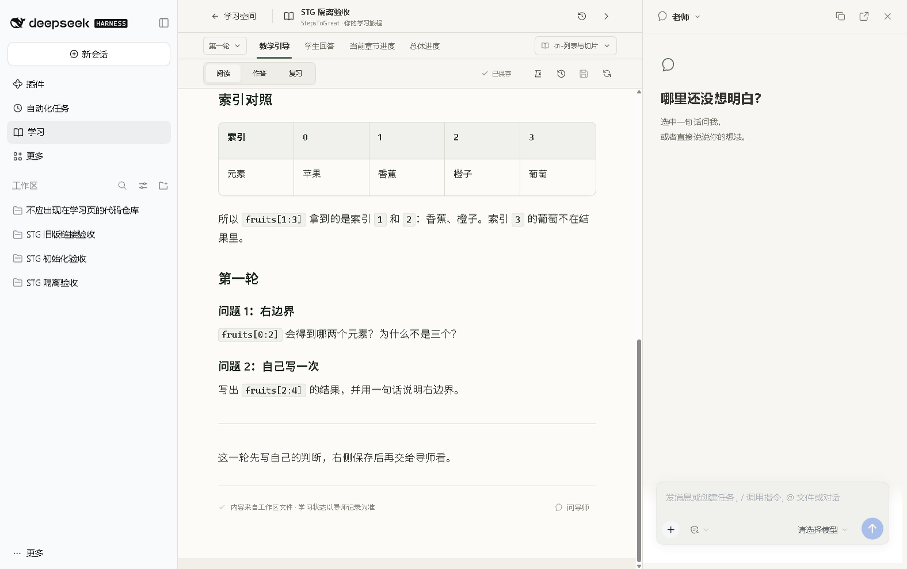<br>
      <sub><strong>原生三栏学习工作台。</strong>左侧选择学习空间与课程，中间阅读带表格/公式/代码的教学引导并逐题作答，右侧连接 DSH 导师边学边问。</sub>
    </td>
    <td width="50%" valign="top">
      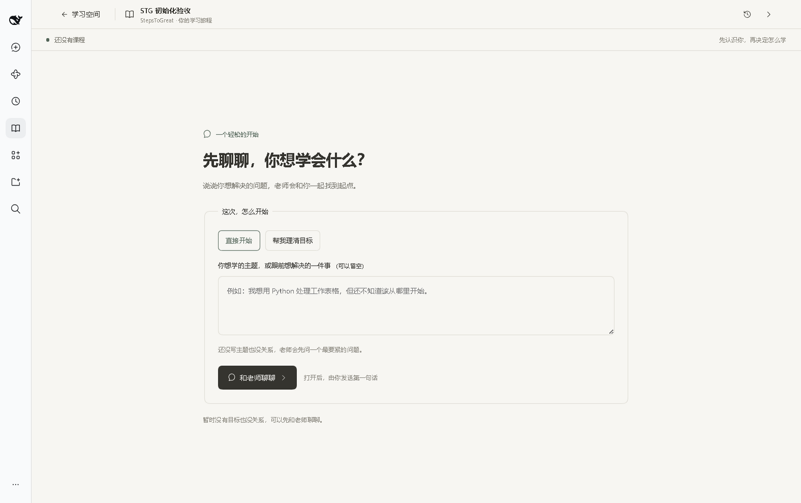<br>
      <sub><strong>两种自然开场方式。</strong>已有明确疑问选「直接开始」直接切入第一步；方向还模糊选「帮我理清目标」，导师每次只问一个必要问题帮你定起点。</sub>
    </td>
  </tr>
  <tr>
    <td width="50%" valign="top">
      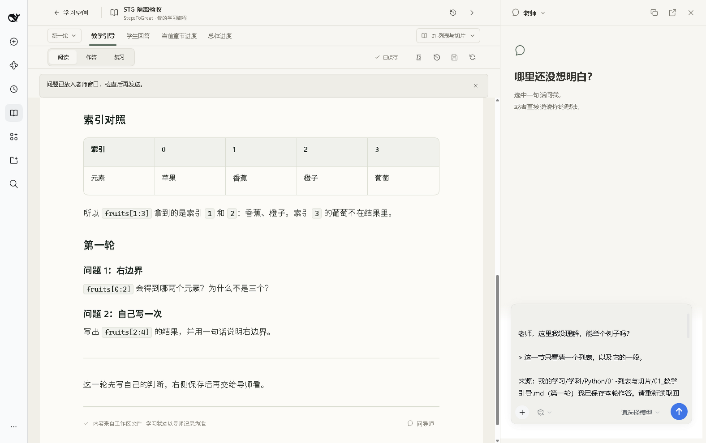<br>
      <sub><strong>划词引文直达导师。</strong>在教学正文选中任意段落点提问，系统自动把引用原文、文件路径与轮次出处填入导师输入框，核对后直接发送。</sub>
    </td>
    <td width="50%" valign="top">
      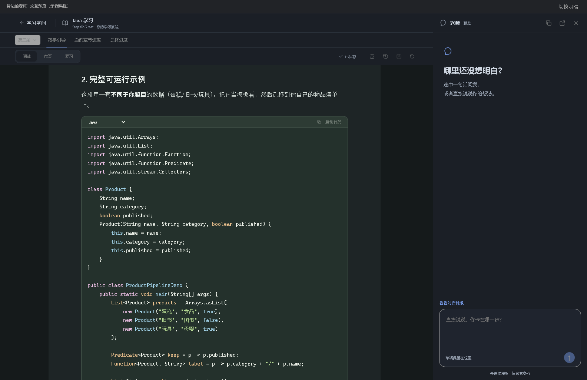<br>
      <sub><strong>深浅主题自适应阅读与编辑。</strong>支持 KaTeX 公式、表格、本地图片（PNG/JPEG/GIF/WebP）及带复制按钮的语法高亮代码块，支持直改源文或所见即所得。</sub>
    </td>
  </tr>
  <tr>
    <td width="50%" valign="top">
      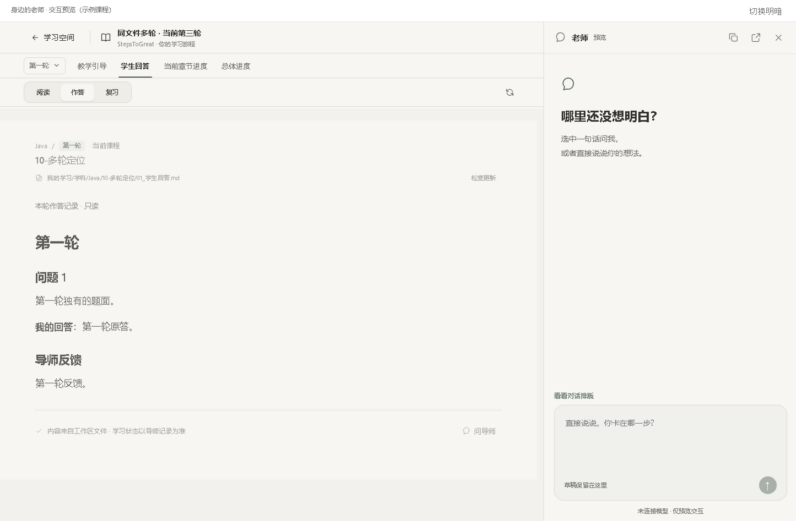<br>
      <sub><strong>轮次切换与历轮复盘。</strong>左上角切换学习轮次，在「复习」标签集中回看当轮原题、已保存的原答与导师三维评估反馈；切回当前轮可接着写草稿。</sub>
    </td>
    <td width="50%" valign="top">
      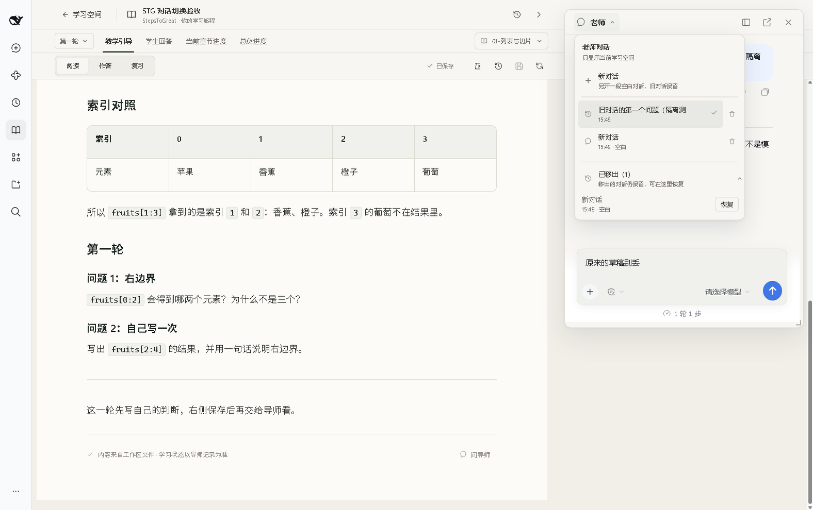<br>
      <sub><strong>可恢复的导师会话归档。</strong>支持「继续原对话」「用新主题重新开始」，以及从导师菜单安全「移出」旧对话并在「已移出」中随时一键恢复，绝不误删历史或丢草稿。</sub>
    </td>
  </tr>
  <tr>
    <td width="50%" valign="top">
      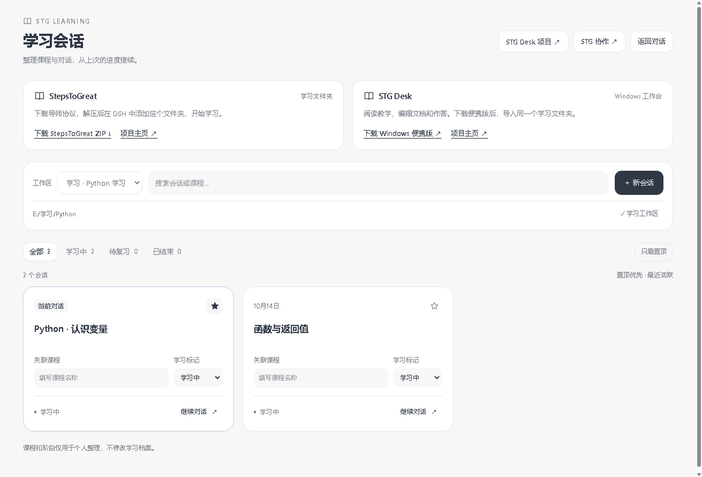<br>
      <sub><strong>学习会话管理页。</strong>按工作区聚合课程对话，支持「学习中 / 待复习 / 已结束」筛选、置顶与快速检索，还可一键跳转同目录下的 STG Desk。</sub>
    </td>
    <td width="50%" valign="top">
      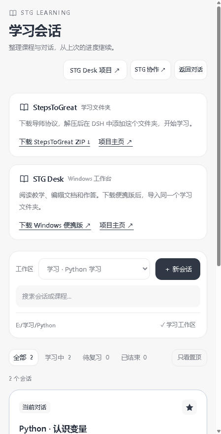<br>
      <sub><strong>窄屏响应式适配。</strong>侧栏或小窗宽度下界面自动重组为单列卡片与紧凑工具栏，不遮挡主要学习入口。</sub>
    </td>
  </tr>
</table>

> 以上截图均来自隔离验收环境与示例课程，不包含真实用户学习记录或模型对话。

---

## 安装并开始学习

1. **安装插件**：从 [GitHub Releases](https://github.com/wildcat430524/dsh-stg-learning/releases/latest) 下载 `dsh-stg-learning-*.tgz`，打开 DSH 的「插件」页选择从本地文件安装并启用（若提示重启，保存当前工作后重启 DSH）。
2. **打开学习空间**：从左侧边栏进入「学习」——新用户选 **「新学习」** 创建空白档案与目录；已有 StepsToGreat 目录选 **「导入已有 StepsToGreat 文件夹」** 并选中根目录。
3. **写下目标或直接开课**：首次开场可填写主题或眼前的具体卡点，选「直接开始」或「帮我理清目标」，点「和老师聊聊」检查草稿后发送。

<details>
<summary><strong>使用 DSH CLI 命令行安装</strong></summary>

```sh
dsh plugin --profile desktop add /absolute/path/dsh-stg-learning-0.5.19.tgz
```

</details>

---

## 文件保存在哪里

| 内容 | 保存位置与恢复保障 |
| :--- | :--- |
| 教学引导、原答、评估与档案 | 你选定的学习目录内的 Markdown 文件，写入前检查版本 |
| 课程与会话关联、文档备份 | 学习目录下的 `.stg-desk/`；可在「文档历史」先预览再恢复（恢复前备份当前版本） |
| 未保存文档与作答草稿 | 当前 DSH 页面使用的本机浏览器存储（外部修改时保留草稿并提示对照） |
| 导师对话、模型与账户设置 | DSH 原生存储管理 |

> 支持 UTF-8 Markdown 和 TXT（单文件上限 8 MiB），支持公式、代码、表格与本地 PNG/JPEG/GIF/WebP 图片；PDF / Word 建议先转为 Markdown。

---

## StepsToGreat 开源生态

插件与桌面工作台、独立文件夹和 Agent Skill 共享同一套本地学习目录——例如在 DSH 插件里和导师完成一轮评估后，可直接用 **STG Desk** 打开同一个目录做所见即所得精读与离线作答：

<p align="center">
  <picture>
    <source media="(prefers-color-scheme: dark)" srcset=".github/assets/ecosystem-zh-dark.png">
    <source media="(prefers-color-scheme: light)" srcset=".github/assets/ecosystem-zh-light.png">
    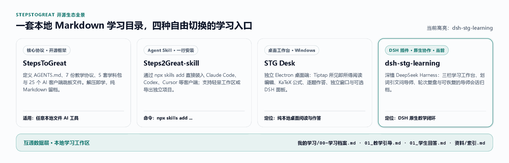
  </picture>
</p>

| 项目 | 定位 | 与本插件关系 |
| :--- | :--- | :--- |
| [StepsToGreat](https://github.com/wildcat430524/StepsToGreat) | 开放教学协议与文件夹框架 | 定义学习目录、轮次规范与档案结构，可 [下载学习框架 ZIP](https://github.com/wildcat430524/StepsToGreat/archive/refs/heads/main.zip) |
| [Steps2Great-skill](https://github.com/wildcat430524/Steps2Great-skill) | Agent Skill (`npx skills add`) | 提供工作台内置的导师教学协议与状态校验规范 |
| [STG-Desk](https://github.com/wildcat430524/STG-Desk) | Windows 独立桌面工作台 | 可与本插件直接打开同一个学习文件夹，接续读写同一份 Markdown |
| **dsh-stg-learning**（本仓库） | DeepSeek Harness 原生插件 | 在 DSH 内部集成课程工作台、划词提问与可恢复导师会话管理 |

---

## 常见问题

<details>
<summary><strong>「保存作答」和「保存并准备评估」有什么区别？</strong></summary>

点 **「保存作答」** 只把答案写入本地学生回答文档；需要导师按三维标准复核时，点 **「保存并准备评估」**，系统会同时保存答案并把评估请求草稿放进 DSH 输入框，由你核对后发送。

</details>

<details>
<summary><strong>新建空间后为什么提示「还没有课程」？</strong></summary>

新建空间先提供空白档案与学习框架。先点「和老师聊聊」沟通你想学的主题，导师发布第一课后学习页即可自动加载课件。

</details>

<details>
<summary><strong>导入已有目录时应该选哪一层？</strong></summary>

请选择包含 `我的学习/00-学习档案.md` 以及导师协议或 `.steps2great.json` 标记的 **StepsToGreat 项目根目录**。

</details>

---

## 项目文档

| 文档 | 说明 |
| :--- | :--- |
| [学习空间说明](docs/LEARNING-SPACES.md) | 新建、导入、旧目录识别及学习目录组成 |
| [原生会话集成](docs/NATIVE.md) | 插件如何连接 DSH 原生导师会话、预填草稿与返回学习页 |
| [宿主文件接口](docs/HOST.md) | 文件读写、版本校验与文档恢复契约 |
| [验收记录](VERIFICATION.md) | 已验证的 DSH 宿主版本、测试范围与验收命令 |

---

## 开发、测试与贡献

需要 **Node.js 24+**。在仓库根目录运行：

```sh
npm ci
npm run build
npm test
```

- 运行 `npm pack` 生成 `.tgz` 安装包；浏览器及原生宿主验收需设置本机 Electron 路径 `STG_ELECTRON_PATH` 后运行 `npm run test:browser` 或 `npm run test:native`。
- 提交 Bug 或建议时请附上插件版本、DSH 版本与脱敏复现步骤。[提交 Issue](https://github.com/wildcat430524/dsh-stg-learning/issues/new) · 如果这个插件帮到了你，欢迎点一颗 ⭐ Star！

## 许可证

本插件代码采用 [MIT](LICENSE)。复用的 STG Desk 组件与打包依赖保留各自许可说明，详见 [第三方许可清单](THIRD-PARTY-NOTICES.md)。
