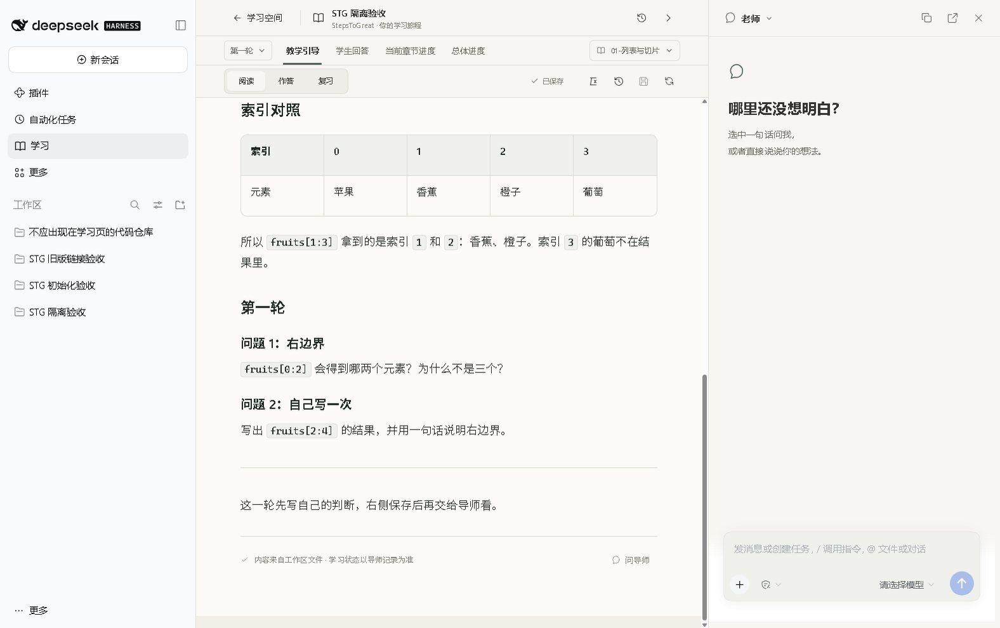
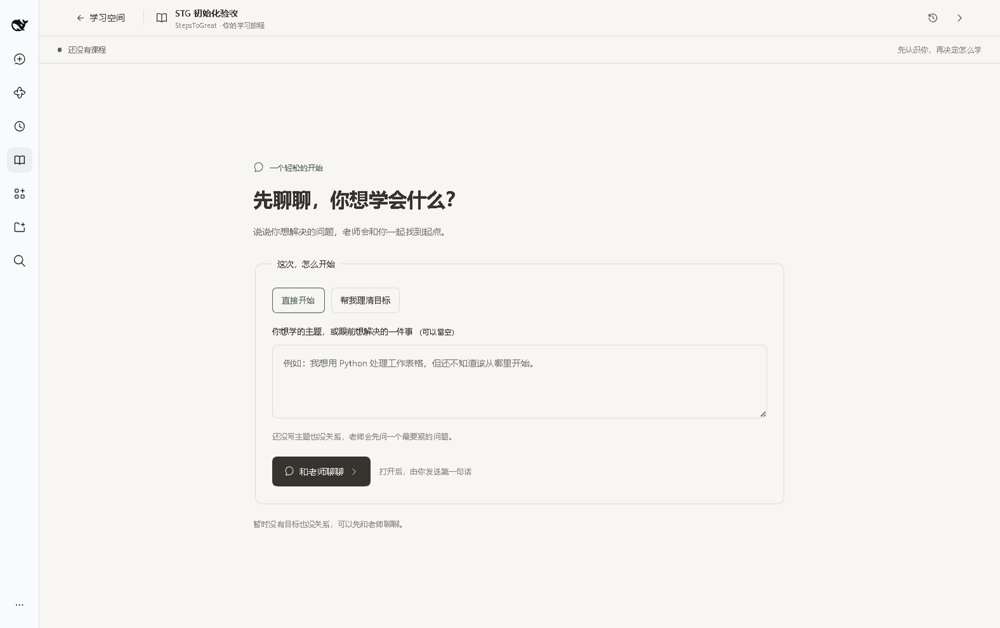
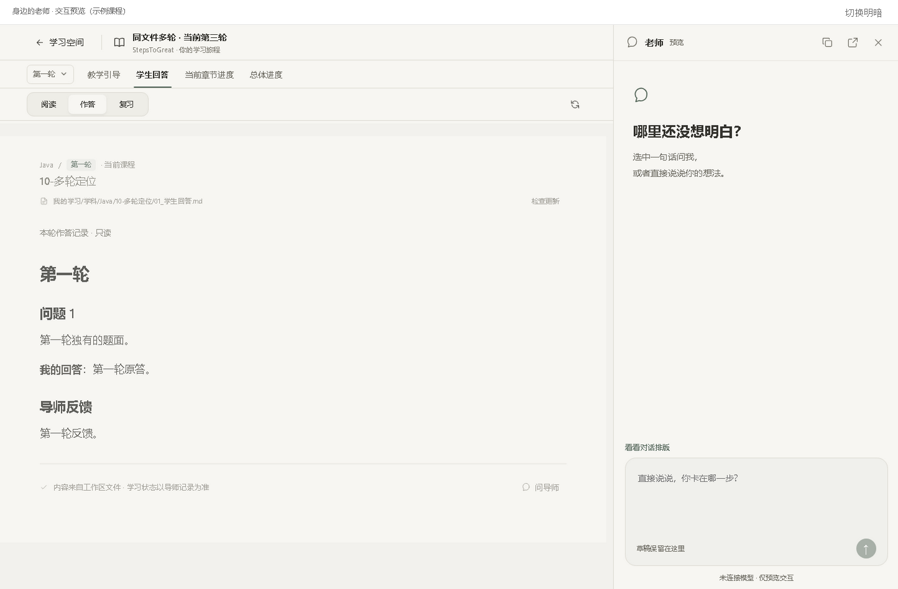
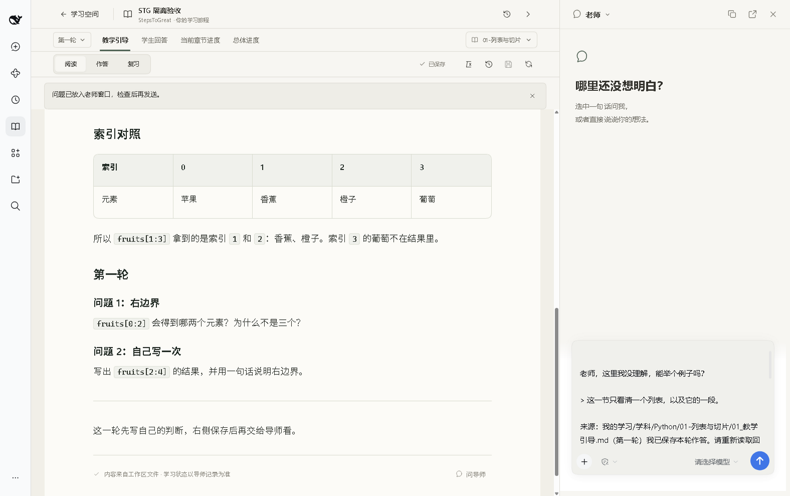
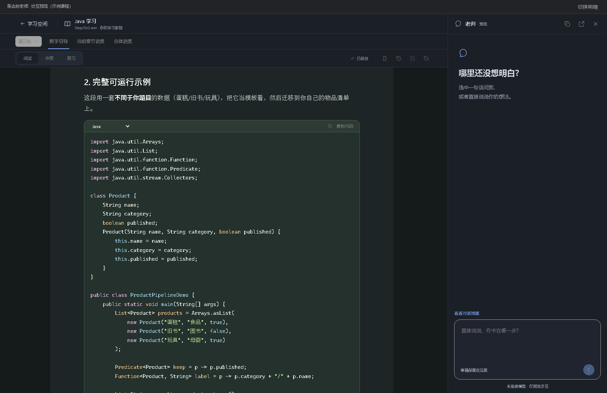
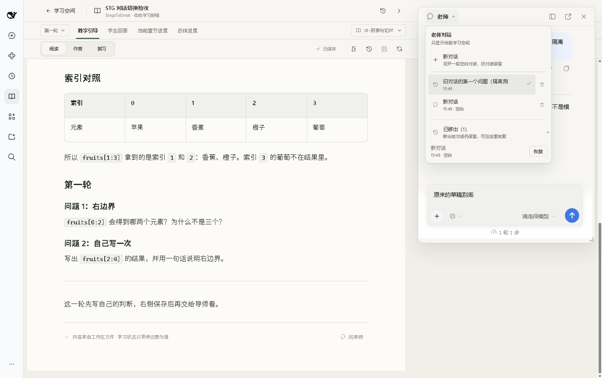

# STG Learning Workbench

**在 DeepSeek Harness（DSH）里学习 StepsToGreat 课程。** 从你想解决的问题开始，边读课边问导师，写下自己的答案，再带着原答和反馈继续下一轮。课程和学习记录以 Markdown 文件保存在你选择的学习目录中。

[](https://github.com/wildcat430524/dsh-stg-learning/releases/latest)
[](https://github.com/wildcat430524/dsh-stg-learning/actions/workflows/ci.yml)

**[下载安装包](https://github.com/wildcat430524/dsh-stg-learning/releases/latest)** · [快速开始](#安装并开始学习) · [学习流程](#学习工作台) · [常见问题](#常见问题) · [项目文档](#项目文档) · [MIT 许可证](LICENSE)



*Python 示例课程。教学引导和导师对话可以同时打开。*

## 功能概览

| 你想做什么 | 工作台提供什么 |
| --- | --- |
| 开始一个新主题 | 创建学习空间和空白档案。可以直接带着问题开始，也可以先和导师理清目标。 |
| 边读边问 | 阅读支持公式、代码、表格和本地图片。选中课文即可带着原文向导师提问，可在侧栏或浮窗继续对话。 |
| 做完练习，请导师评估 | 把自己的答案保存到学生回答文档，再发送当前轮次的评估请求。导师可以结合题目、原答和学科规则给出反馈。 |
| 找回学习进度 | 从档案记录的课程和轮次继续。历史轮可以回看原题、作答和反馈，当前轮草稿可以接着写。 |
| 管理导师对话和本地资料 | 可以另开对话、归档和恢复会话，也可以在 DSH 和 STG Desk 中打开同一个学习目录。 |

## 安装并开始学习

v0.5.17 通过 DSH 0.2.2-rc.1 的隔离宿主验收。安装包在 `engines.dsh` 声明兼容 DSH 0.2.1-rc.1 至 rc.5，以及 0.2.2-rc.1。[v0.5.17 发布说明](docs/releases/v0.5.17.md)

1. **安装插件**。下载 Release 附件中的 `dsh-stg-learning-*.tgz`。打开 DSH 的「插件」页，从本地文件安装并启用。若提示重启，保存当前工作后重启 DSH。
2. **打开学习空间**。从左侧进入「学习」。新用户选择「新学习」，填名称并选择新文件夹的上一级目录。已有 StepsToGreat 资料时，点「导入已有 StepsToGreat 文件夹」，选择学习目录的根目录。
3. **开始学习**。首次打开时，写下主题、基础或眼前的问题，选择开场方式，再点「和老师聊聊」。检查 DSH 输入框里的草稿后发送。已有课程的空间会打开档案记录的当前课程和轮次。

新建和导入通过 DSH 桌面端的文件夹选择器完成。导师使用 DSH 中配置的模型，阅读、编辑、保存作答和查看历史可独立使用。

<details>
<summary>使用命令行安装</summary>

使用与桌面端匹配的 DSH CLI，把命令中的路径换成下载包的绝对路径。

```text
dsh plugin --profile desktop add /absolute/path/dsh-stg-learning-0.5.17.tgz
```

</details>

### 第一次开场怎么选

| 开始方式 | 适合什么时候用 |
| --- | --- |
| **直接开始** | 已经有主题、疑问或任务。导师会从你描述的基础和问题切入，讲清可以先做什么，需要时再举例。 |
| **帮我理清目标** | 知道大致方向，但还拿不准想学到什么程度。导师会一次问一个问题，和你确定适合的起点。 |

开场可以写得像平时提问一样。比如「我会写简单的 Python 循环，但总弄不清切片的右边界。我想学会自己判断切片会取到哪些元素。」也可以留空，先和导师聊。

<details>
<summary>查看学习开场界面</summary>



</details>

## 学习工作台

### 一轮课程怎么用

1. **读教学引导**。以首页截图里的列表切片为例，先看索引对照表和本轮题目。遇到卡点可以选中课文，再问导师「为什么 `fruits[1:3]` 取不到索引 3？」。提问时会带上选中的内容。
2. **写下自己的判断**。切到「作答」，逐题填写答案和理由。点「保存作答」将原答写入学生回答文档。课文可以在阅读区直接编辑，也可以切换到 Markdown 源文。
3. **请导师评估**。点「保存并准备评估」，确认原生 DSH 输入框中的请求并发送。导师按学科规则复核这一轮的原答，掌握状态以文档中的评估记录为准。
4. **回看哪一步卡住了**。在顶部切换轮次，打开「复习」查看当时的题目、原答和导师反馈。切回当前轮可接着写草稿。需要找另一课时，打开顶部课程菜单搜索。



*回看历史轮时，可以一起查看题目、原答和反馈。图中使用示例课程。*

<details>
<summary>查看选段提问与深色阅读界面</summary>



*选段提问后，引用和出处会放进导师输入框，检查后再发送。*



*深色主题下的 Java 代码阅读预览。*

</details>

### 继续、重开与恢复对话

- **接着聊**。在原生导师对话点「学习内容」返回学习页。尚未开课时，可以点「继续原对话」回到原来的讨论和草稿。
- **换个目标**。开场页的「用新主题重新开始」会按你编辑后的主题新开一段对话。原对话可以从导师菜单找回。
- **整理对话**。在导师菜单或「学习会话」页移出选中的对话，确认框会显示它的名称。之后可以在「已移出」中点「恢复」，找回同一段对话。移出采用 DSH 的可恢复归档。



*在导师菜单展开「已移出」，可以恢复选中的对话。当前对话的草稿仍显示在输入框里。*

## 文件保存在哪里

| 内容 | 位置 |
| --- | --- |
| 教学、原答、评估和学习档案 | 你选择的学习目录中的 Markdown 文件 |
| 课程与会话关联、文档备份 | 学习目录下的 `.stg-desk/` |
| 未保存的文档和作答草稿 | 当前 DSH 页面使用的本机浏览器存储 |
| 导师对话、模型和账户设置 | DSH 原生存储 |

需要撤回一次文档修改时，打开「文档历史」，先预览要找回的内容，再点「恢复此版本」。恢复前会备份当前文件。课文在编辑期间被其他程序修改时，工作台会保留草稿并提示对照。

工作台支持 UTF-8 Markdown 和 TXT，每份文档最多 8 MiB。阅读支持公式、代码、表格及 PNG、JPEG、GIF、WebP 本地图片。PDF 或 Word 资料可以先转成 Markdown 再阅读。

## 常见问题

**装好后从哪里打开？** 在 DSH 的「插件」页确认已启用，按界面提示重启后，从侧栏找「学习」。

**导入时该选哪一层目录？** 选择 StepsToGreat 的项目根目录。这个目录应包含 `我的学习/00-学习档案.md`，并有导师协议或 `.steps2great.json` 初始化标记。

**新建后为什么显示「还没有课程」？** 新学习空间先提供空白档案和学习框架。可以先点「和老师聊聊」沟通目标，导师准备好第一课后，学习页就能打开对应课件。

**只想保存作答，该点哪个按钮？** 点「保存作答」会把答案写进学生回答文档。要请导师复核时，点「保存并准备评估」，再到 DSH 输入框确认发送。

**草稿和已保存的答案怎么备份？** 已保存的原答在学习目录里，可随目录一起备份。需要随文件备份的草稿，先在工作台保存为文档。导师会话及其输入草稿由 DSH 管理。

**能和 STG Desk 共用同一套资料吗？** 可以。在两边打开同一个 StepsToGreat 学习目录，就能接着读和写原来的 Markdown 文件。编辑同一篇文档时，先在一端保存，再到另一端继续。

## 相关项目

- StepsToGreat 定义学习目录、课程和档案的结构。[项目主页](https://github.com/wildcat430524/StepsToGreat) · [下载学习框架 ZIP](https://github.com/wildcat430524/StepsToGreat/archive/refs/heads/main.zip)
- STG Desk 是独立的桌面阅读、编辑与作答应用，可与插件打开同一个学习目录。[项目主页](https://github.com/wildcat430524/STG-Desk) · [下载 STG Desk](https://github.com/wildcat430524/STG-Desk/releases/latest)
- Steps2Great-skill 提供导师使用的教学方法和参考规则。[项目主页](https://github.com/wildcat430524/Steps2Great-skill)

## 项目文档

| 文档 | 内容 |
| --- | --- |
| [学习空间](docs/LEARNING-SPACES.md) | 新建、导入、旧目录识别，以及学习文件夹由哪些部分组成 |
| [原生会话集成](docs/NATIVE.md) | 插件如何打开 DSH 原生导师会话、准备输入草稿和返回学习内容 |
| [宿主文件接口](docs/HOST.md) | 文件读取、写入、版本检查与恢复 |
| [验收记录](VERIFICATION.md) | 已验证的 DSH 版本、测试命令与测试范围 |

## 开发与反馈

开发需要 Node.js 24+。在仓库根目录安装依赖、构建并运行测试。

```sh
npm ci
npm run build
npm test
```

`npm pack` 生成安装包。浏览器和宿主验收使用临时学习目录，运行 `npm run test:browser` 或 `npm run test:native` 前需设置本机 Electron 路径 `STG_ELECTRON_PATH`。

遇到问题时，可以附上插件版本、DSH 版本、操作步骤和看到的结果。涉及学习内容时，可使用脱敏截图或示例目录复现。[提交 Issue](https://github.com/wildcat430524/dsh-stg-learning/issues/new)

## 许可证

插件采用 [MIT](LICENSE)。复用的 STG Desk 组件和打包依赖保留各自的许可说明，见 [第三方许可清单](THIRD-PARTY-NOTICES.md)。
